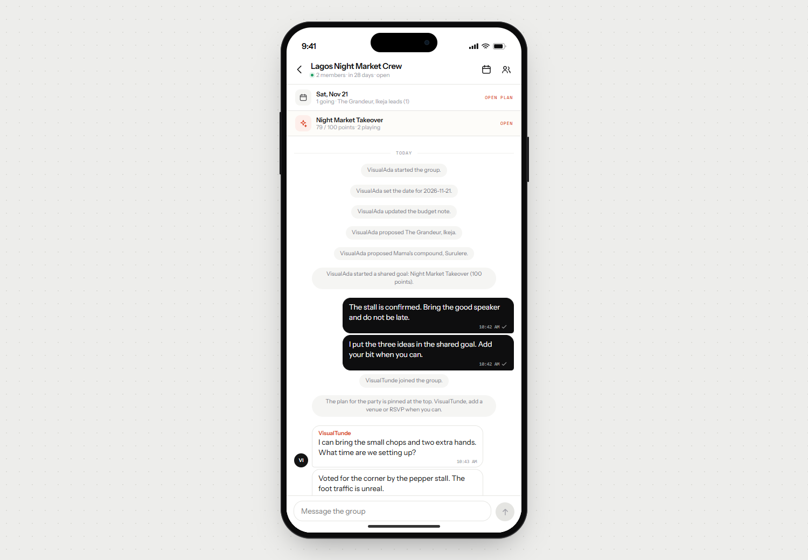
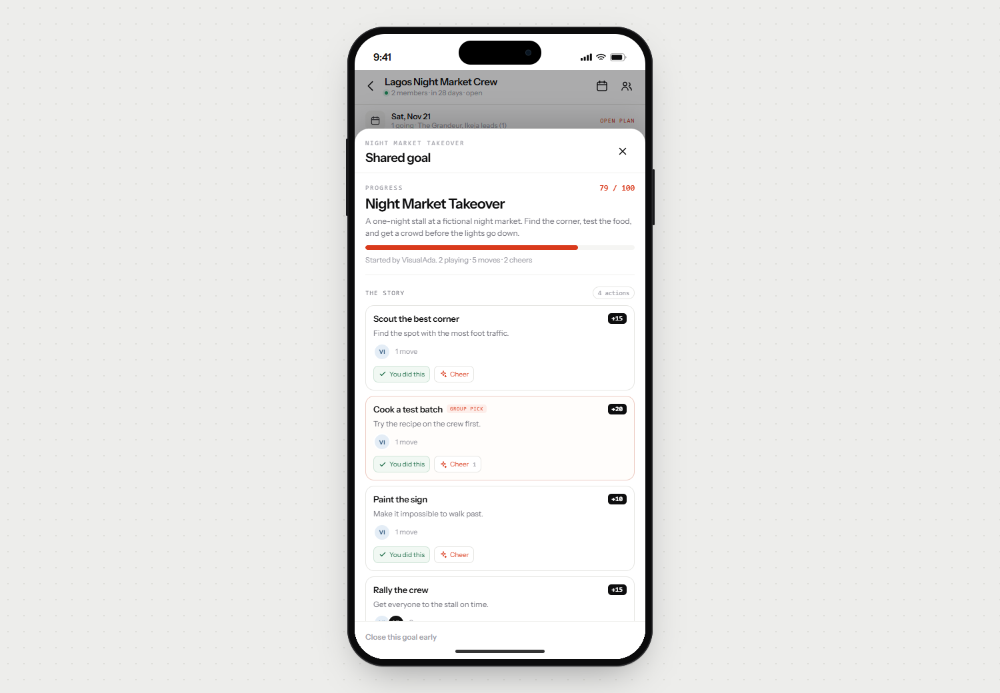

# The Group Admin

A small social game for groups of people who actually know each other. Sign up with a
username, start a private community, talk, plan an owambe — or start a fictional **shared
goal** and move a story forward together.



This is milestone three. The party plan is still here as one activity, but it no longer
defines the app: groups can now be discovered in Explore, and every group can run one
non-party activity at a time.

## What it does

- **Accounts** — username + password, no email needed. The username is the identity
  everyone sees.
- **Communities** — anyone can start one; the creator is the admin. New groups are
  **invite-only by default**. The admin can switch a group to **discoverable**, which lists
  it in Explore so any signed-in player can join without a code.
- **Invites** — every group keeps its eight-character code and `/join/<code>` link, including
  discoverable groups. The admin can rotate the code and invalidate the old one.
- **Explore** — a directory of discoverable groups with member counts, a short description,
  recent activity, and any running shared goal.
- **Chat** — real free-text messages plus system events (joins, proposals, plan updates,
  goal starts and outcomes). Other people's messages arrive by polling every two seconds.
- **One party plan per group** — the admin sets the date, budget note and confirmed venue;
  every member can propose venues, vote, and RSVP yes / maybe / no. The admin locks it when
  the group has decided.
- **One Shared Goal per group** — pick a fictional scenario and a point target, then take
  actions and cheer the next one. The sheet shows group progress, each person's
  participation, the group's pick, and a short outcome when the goal is reached. Finished
  goals move to the group's history.
- **Community safety** — members can **report** another member (the report goes only to the
  group admin) and **block** someone, which hides that person's chat messages from them.
  The admin can remove anyone; removal revokes access immediately and clears that person's
  current RSVP and venue votes.

### Fictional points only

Shared Goal points are a story device. There is no money, token, wallet, cash-out, purchase,
prize, or real-world value anywhere in the activity. Cheering is free.



## Run it

```bash
npm install
npm run dev
```

`npm run dev` starts an embedded Postgres (PGlite speaking the Postgres wire protocol on
`127.0.0.1:5433`) and then Next.js on <http://localhost:3000>. Data lives in `.data/pg` and
survives restarts.

```bash
npm run dev      # app + local database
npm run build    # production build (needs DATABASE_URL)
npm run start    # serve the production build
npm test         # unit tests: hashing, validation, scenarios, ids, formatting, merge
npm run test:e2e # multi-account acceptance check against a running server
npm run db:reset # wipe the local database
```

### What `npm run test:e2e` proves

It drives the real HTTP API with three separate cookie jars and checks the community flow
end to end: accounts, invites, chat, a party plan, discoverable groups, Explore, reports,
blocks, shared goals, and removal behaviour.

```
PASS Alice creates an account
PASS Bob joins Alice's group with the code
PASS Bob receives Alice's message by polling
PASS The group card carries that group's invite code
PASS Removal clears the removed member's RSVP
PASS Removal clears the removed member's venue vote
PASS The group card updates after a code rotation
PASS A player joins a discoverable community without a code
PASS A member can report another member
PASS The admin can mark a report handled
PASS A blocked person's messages disappear from the blocker's view
PASS A member starts a shared goal
PASS Cheering an action adds momentum
PASS Reaching the goal completes the activity
PASS A closed goal is kept in history
...
73/73 checks passed
```

The demo group is claimed by the **first** account created in a database. On a fresh
database it now includes a seeded party plan, chat history and a running Night Market shared
goal; later accounts start empty. On an existing database that group stays exactly as it
was, and the script creates a fresh group instead when the demo is already claimed.

## Authentication

- Passwords are hashed with **PBKDF2-HMAC-SHA256, 210,000 iterations, 16-byte random salt per
  user**, stored as `pbkdf2$sha256$iterations$salt$hash`. Raw passwords are never stored or
  logged.
- Sessions are 32 random bytes. Only the **SHA-256 hash** of the token is stored, so a
  database leak cannot be replayed. The cookie is `HttpOnly`, `SameSite=Lax`, `Secure` in
  production, 30 days.
- Logins are throttled per username (8 attempts / 10 minutes), and login errors do not reveal
  whether a username exists.
- Every group route resolves membership server-side; non-members get `404` rather than `403`
  so private groups cannot be probed. Writes also reject cross-site `Origin`s.
- Reports can only be read by the admin of that group. Blocking is per-user and server-side:
  the blocked person's messages are filtered from the blocker's chat, list preview, and sync.
- **Why no email?** Testing does not need recovery flows, and usernames keep sign-up to two
  fields. `users.email` is already in the schema (unique, nullable) for a future addition.

## Deploy to Vercel

1. Create a Postgres database — [Neon](https://neon.tech) free tier is the intended target
   (Vercel's own Postgres is Neon-backed). Copy the **pooled** connection string.
2. Import this repository into Vercel. The build command stays `npm run build`; no extra
   configuration is needed.
3. Add `DATABASE_URL` in Project → Settings → Environment Variables, then deploy.
4. Tables and the new columns are created on first request (`lib/schema.ts`, idempotent
   `create table if not exists` and `alter table ... add column if not exists`). There is no
   separate migration command and no data reset.

Existing accounts, groups, messages and plans are preserved. Groups created before this
milestone default to `invite`; the admin can make them discoverable from People → Community.

Locally you can also point `DATABASE_URL` at any Postgres (including Neon) and run
`npm run dev:next`, which skips the embedded database.

## Structure

```
app/
  layout.tsx              device shell + fonts
  globals.css             the whole design system
  page.tsx                redirects to /groups or /login
  login/                  sign in / create account
  explore/                discoverable communities
  join/[code]/            invite landing page
  groups/                 group list, chat room
  api/auth/*              register, login, logout
  api/groups/*            groups, explore, invites, messages, sync, plan, members, reports
  api/groups/[id]/activity/*  shared goal (start, contribute, cheer, close)
  api/users/[id]/block/   per-user block toggle
components/
  DeviceFrame, ChatRoom, GroupsScreen, ExploreScreen, ActivitySheet,
  PlanSheet, MembersSheet, AuthScreen, avatars, icons
lib/
  db.ts                   Postgres pool (globalThis-scoped)
  schema.ts               tables and additive columns
  auth.ts                 PBKDF2 + session tokens
  session.ts              cookie helpers
  store.ts                groups, chat, plan, reports, blocks, shared goals
  activities.ts           fictional scenarios, actions, progress and outcomes
  seed.ts                 the demo group
  validate.ts             input rules shared by API and tests
scripts/
  dev.mjs                 embedded Postgres + Next
  e2e.mjs                 multi-account acceptance check
tests/unit.test.ts
```

## Notes and limits

- **Schema changes are additive.** The new `visibility` and `description` columns are added
  with `alter table ... add column if not exists`; new tables are created if missing. No
  existing rows are deleted or reseeded.
- **Polling, not sockets**: `/api/groups/[id]/sync?after=<seq>` returns messages newer than
  the last sequence number you have, plus the plan, members, blocked list and current goal.
  Two-second interval, paused while the tab is hidden. Fine for a handful of testers on
  Vercel's serverless runtime; a socket layer would need Durable Objects or a realtime service.
- One connection per server process (`max: 1`) to stay friendly to serverless limits.
- Message rate limit: 20 messages per minute per person per group. Message length cap: 1000
  characters. Activity notes: 140 characters.
- One admin per group (the creator). If the admin leaves there is no ownership-transfer flow.
- One party plan and one **active** shared goal per group. Finished goals (up to eight) are
  kept in the activity sheet's history.
- A goal can only be closed by the group admin or the person who started it. A group whose
  goal is unreachable can close it and start a smaller one.
- Reports are visible only to the admin of that group; there is no platform-wide moderation
  queue yet. Blocking hides chat messages from the blocker, not the whole group's view, and
  does not remove the blocked person from the group.
- Removal clears the removed person's RSVP and venue votes immediately. Their past messages
  and shared-goal contributions remain as group history.
- The phone frame is a presentation device on desktop; below 700px the app fills the screen
  and respects safe-area insets.
