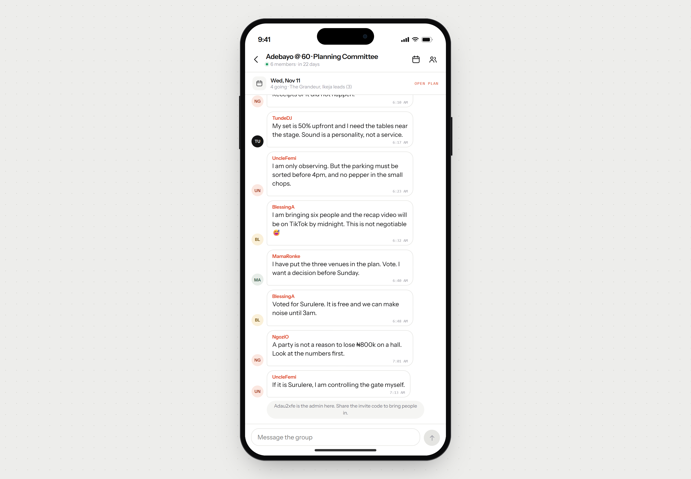

# The Group Admin

An invite-only group chat for planning an owambe. Sign up with a username, start a group, send someone the code, and decide one party plan together — date, venue, RSVP, budget.

This is milestone two: the single-player prototype is gone and the app is now a small multi-user product with real accounts, shared groups and a shared party plan.



## What it does

- **Accounts** — username + password, no email needed. The username is the identity everyone sees in the group.
- **Groups** — anyone can start one; the creator is the admin.
- **Invites** — every group has an eight-character code and a `/join/<code>` link. Anyone with it joins instantly. Admins can rotate the code (which invalidates the old one) and remove members.
- **Chat** — text messages plus system events (joins, proposals, plan updates). Other people's messages arrive by polling every two seconds.
- **One party plan per group** — the admin sets the date, budget note and confirmed venue; every member can propose venues, vote on them, and RSVP yes / maybe / no. The admin locks the plan when the group has decided.
- **Empty states** — a brand-new account, a quiet group, no venues, no date, nobody RSVP'd yet.

Deliberately out of scope: AI replies, payments, public group discovery, notifications, file uploads, password reset.

## Run it

```bash
npm install
npm run dev
```

`npm run dev` starts an embedded Postgres (PGlite speaking the Postgres wire protocol on `127.0.0.1:5433`) and then Next.js on <http://localhost:3000>. Data lives in `.data/pg` and survives restarts.

```bash
npm run dev      # app + local database
npm run build    # production build (needs DATABASE_URL)
npm run start    # serve the production build
npm test         # unit tests: hashing, validation, ids, formatting, merge
npm run test:e2e # two-account acceptance check against a running server
npm run db:reset # wipe the local database
```

### What `npm run test:e2e` proves

It drives the real HTTP API with three separate cookie jars and checks the milestone's acceptance criterion end to end: two accounts join the same group, see each other's messages, and collaborate on the same plan — while a non-member and a removed member are refused.

```
PASS Alice lands in the seeded demo group
PASS Bob joins Alice's group with the code
PASS Bob receives Alice's message by polling
PASS Alice receives Bob's reply by polling
PASS Alice's vote stacks on Bob's (2 votes)
PASS Non-members cannot read the group's messages (404)
PASS Admin removes Bob
PASS Removed member loses access at once (404)
...
32/32 checks passed
```

The demo group is claimed by the **first** account created in a database, so a tester lands in a group with history and an invite code instead of an empty shell. Later accounts start empty (that path shows the empty state). On a second run the script notices the demo group is taken, creates a group instead, and still runs every other check.

## Authentication

- Passwords are hashed with **PBKDF2-HMAC-SHA256, 210,000 iterations, 16-byte random salt per user**, stored as `pbkdf2$sha256$iterations$salt$hash`. Raw passwords are never stored or logged.
- Sessions are 32 random bytes. Only the **SHA-256 hash** of the token is stored, so a database leak cannot be replayed. The cookie is `HttpOnly`, `SameSite=Lax`, `Secure` in production, 30 days.
- Logins are throttled per username (8 attempts / 10 minutes), and login errors do not reveal whether a username exists.
- Every group route resolves membership server-side; non-members get `404` rather than `403` so groups cannot be probed. Writes also reject cross-site `Origin`s.
- **Why no email?** Invite-only testing does not need recovery flows, and usernames keep sign-up to two fields. `users.email` is already in the schema (unique, nullable) so email + password can be added as a second login option without a migration.

## Deploy to Vercel

1. Create a Postgres database — [Neon](https://neon.tech) free tier is the intended target (Vercel's own Postgres is Neon-backed). Copy the **pooled** connection string.
2. Import this repository into Vercel. The build command stays `npm run build`; no extra configuration is needed.
3. Add `DATABASE_URL` in Project → Settings → Environment Variables, then deploy.
4. Tables are created on first request (`lib/schema.ts`, idempotent `create table if not exists`). No separate migration step.

Locally you can also point `DATABASE_URL` at any Postgres (including Neon) and run `npm run dev:next`, which skips the embedded database.

## Structure

```
app/
  layout.tsx              device shell + fonts
  globals.css             the whole design system
  page.tsx                redirects to /groups or /login
  login/                  sign in / create account
  join/[code]/            invite landing page
  groups/                 group list, chat room
  api/auth/*              register, login, logout
  api/groups/*            groups, invites, messages, sync, plan, members
components/               device frame, chat room, sheets, avatars
lib/
  db.ts                   Postgres pool (globalThis-scoped)
  schema.ts               tables
  auth.ts                 PBKDF2 + session tokens
  session.ts              cookie helpers
  store.ts                groups, membership, chat, plan (all access checks)
  seed.ts                 the demo group
  validate.ts             input rules shared by API and tests
scripts/
  dev.mjs                 embedded Postgres + Next
  e2e.mjs                 two-account acceptance check
tests/unit.test.ts
```

## Notes and limits

- **Polling, not sockets**: `/api/groups/[id]/sync?after=<seq>` returns messages newer than the last sequence number you have, plus the plan and member list. Two-second interval, paused while the tab is hidden. Fine for a handful of testers on Vercel's serverless runtime; a socket layer would need Durable Objects or a separate realtime service.
- One connection per server process (`max: 1`) to stay friendly to serverless connection limits.
- Message rate limit: 20 messages per minute per person per group. Message length cap: 1000 characters.
- One admin per group (the creator). If the admin is removed there is no transfer flow yet.
- The phone frame is a presentation device on desktop; below 700px the app fills the screen and respects safe-area insets.
